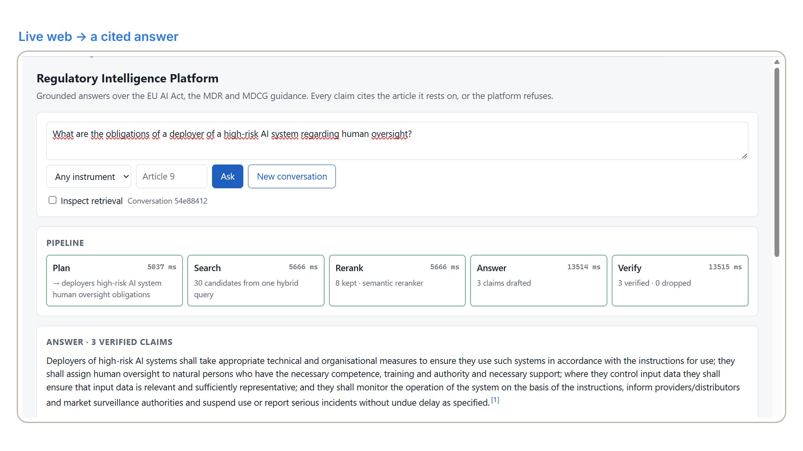
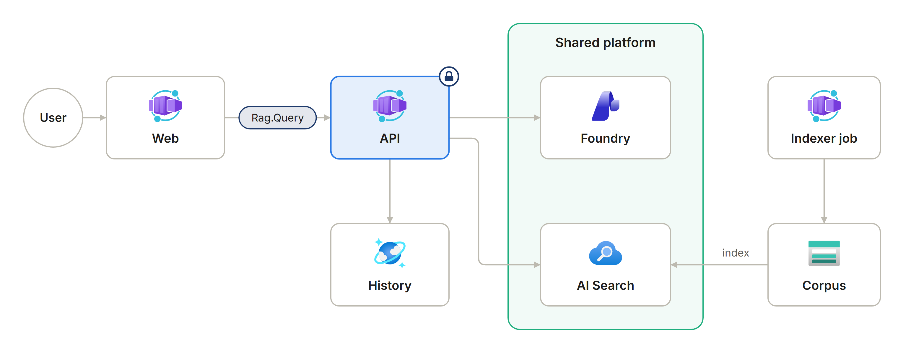
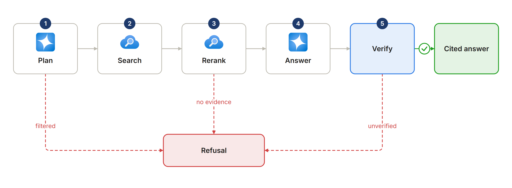
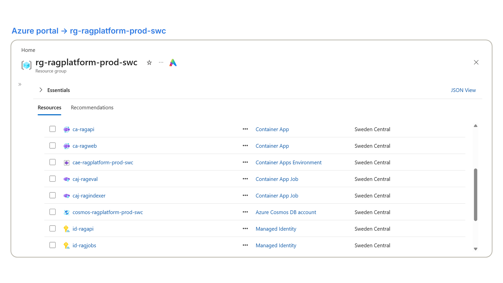
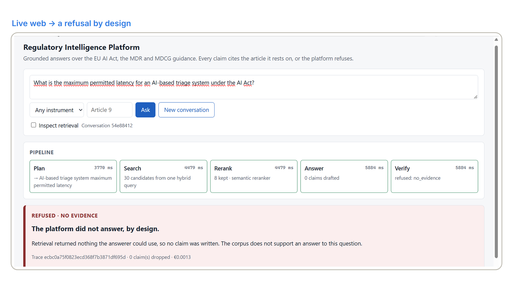
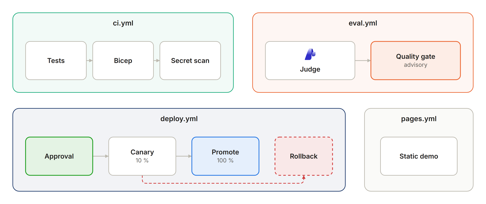
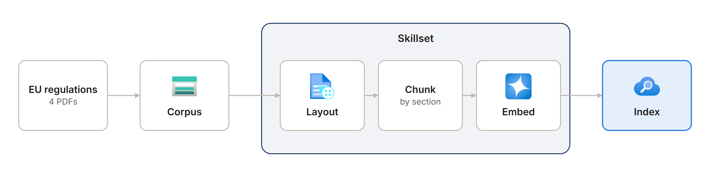

# Regulatory Intelligence Platform

Built by **Rodrigo Martín Gómez del Moral Herranz**

<a href="https://github.com/Rodrigo-GomezdelMoral"></a>&nbsp;&nbsp;<a href="https://www.linkedin.com/in/rodrigo-mart%C3%ADn-g%C3%B3mez-del-moral-herranz"></a>&nbsp;&nbsp;<a href="https://rodrigogomezdelmoralherranz.es"></a>

Grounded document intelligence over a controlled corpus with article-level provenance, built on
Microsoft Agent Framework. The system answers questions about the EU AI Act, the Medical Device
Regulation and MDCG guidance **only when the corpus supports it**, cites the article every claim
rests on, verifies every citation before showing it, and proves all three with measured numbers.

**Live demo:** <https://rodrigo-gomezdelmoral.github.io/azure-rag-platform/> - recorded runs replayed
with their real phase timings, no backend.

A question answered live by the deployed platform: every phase is visible, and each claim is shown
only after its citation is verified.



## The problem

A regulatory affairs specialist at a medical-device manufacturer answers *which risk-management
obligations apply to a high-risk AI system embedded in a class IIb device* by reading hundreds of
pages by hand, and the answer is not traceable to the articles it came from. That specialist costs
60–90 € an hour, and a technical file whose evidence a notified body cannot follow delays a CE mark
by months. A chatbot that answers fluently without a citation is worse than the status quo, because
an invented obligation becomes an audit finding. The buyer is the head of regulatory affairs; what
they buy is time, and the proof that every statement points at a real article.

## What it does

- Answers questions about the EU AI Act, the Medical Device Regulation and MDCG guidance from a controlled corpus, and refuses when the corpus holds no evidence.
- Cites the article behind every claim and verifies each citation before it is shown.
- Shows its work while it runs: plan, search, rerank, answer and verify, streamed as phases.
- Measures itself with golden, unanswerable, multihop and adversarial evaluation sets, run on pull requests.
- Can be tried without Azure in the published demo, with recorded runs replayed at their real timings.

## Repo card

| | |
|---|---|
| **Type** | AI application on the shared cloud platform |
| **Azure services** | Azure Container Apps (API, web, and indexer and evaluation jobs), Azure Cosmos DB, Azure Storage, Application Insights and alerts; shared: Microsoft Foundry, Azure AI Search, Container Registry and Log Analytics |
| **AI** | Microsoft Agent Framework with three agents and structured output; gpt-5-nano plans, gpt-5-mini answers, text-embedding-3-small embeds; one hybrid AI Search query with the semantic ranker |
| **Stack** | Python 3.12 with FastAPI; a React and TypeScript web |
| **Security** | Managed identities and no secrets; Entra at the ingress and the `Rag.Query` app role in the code |
| **Infrastructure and delivery** | Bicep with azd; GitHub Actions with OIDC: `ci`, `eval`, `deploy` (canary with rollback) and `pages` |
| **Demo** | <https://rodrigo-gomezdelmoral.github.io/azure-rag-platform/> |

## Architecture



The pipeline is five steps in a fixed order, written as a function rather than a workflow; progress
is streamed as phase events, never as tokens; a claim is shown once, after verification. There is no
virtual network: the boundary is the token, and the browser never holds one. `docs/architecture.md`
has the container table and the request sequence.





## In action

A question the corpus cannot support: the platform refuses, by design, instead of inventing an
answer.



## What this demonstrates

| Capability | Where |
|---|---|
| Three agents on Microsoft Agent Framework with structured outputs, instructions as versioned files, no tools | `app/agents.py`, `prompts/` |
| Retrieval as one hybrid query with OData filters and the native semantic ranker, plus an agent reranker for comparison | `app/retrieval.py` |
| Deterministic verification of every citation, typed refusals, cost from token usage | `app/answer.py` |
| Entra authentication at the ingress and the `Rag.Query` app role in the code; the session authorised before it exists | `app/main.py`, `infra/modules/apps.bicep` |
| The index built as configuration by the search service's own identity, with safe re-ingestion and quantised vectors | `ops/index.py`, `docs/adr/001-*.md`, `docs/adr/002-*.md` |
| Local and Foundry evaluators, six datasets with a canary in every adversarial row, a judge to be calibrated against human labels | `eval/`, `docs/evaluation.md` |
| Phase timeline, verified-answer panel, citation panel and a retrieval debug panel with scores and rank deltas | `web/src/main.tsx` |
| Quality gate, evaluation gate with a pull-request comment, canary deployment with rollback, static demo | `.github/workflows/` |
| Eleven architecture decisions, three of them rejections | `docs/adr/` |

## Evaluation

The full suite of 2026-10-16 - golden (80, verified by the author that day), unanswerable (30),
multihop (20) and adversarial (25), 155 items - planner `gpt-5-nano`, answerer `gpt-5-mini`,
semantic reranker, report `docs/reports/2026-10-16-full-gpt-5-mini-semantic.json`:

| Metric | Mean | Threshold |
|---|---|---|
| Groundedness (judge, scaled 0–1) | 0.94 | ≥ 0.9 |
| Relevance (judge, scaled 0–1) | 0.88 | reported |
| Citation precision | 0.94 | ≥ 0.95 |
| Recall at 10 | 0.71 | ≥ 0.85 |
| Correct refusal | 0.94 | ≥ 0.9 |
| False refusal | 0.03 | ≤ 0.05 |
| Canary appearances | 0.00 | = 0 |

**The merge gate is red** and the repository says so: definition questions do not retrieve the
definitions article, and the planner's rewrite varies between runs. `docs/evaluation.md` explains
each failure; `experiments/` measures the two obvious levers and finds that neither moves recall:
the same twenty-three golden items are missed whichever Answerer or reranker runs, because their
passages are not among the retrieved candidates at all. The eighty-item golden set was
**verified by the author on 2026-10-16** (`docs/evaluation.md`) and the first full-suite
report after the review is published in `docs/evaluation.md`; the judge's agreement with the
labels of the forty calibration items is κ = 0.90 for groundedness and κ = 0.00 for
relevance (`docs/reports/2026-10-16-calibration-gpt-5-mini-semantic.json`).

On a pull request the gate runs the smoke and adversarial suites, and it is advisory: the `main`
ruleset requires a pull request but no status check, so a red run does not block the merge.



## Cost

Measured by the `repo` tag on 2026-10-15: this resource group has cost €0.0008 month to date,
because nothing in it runs between questions; the shared platform it uses has cost €10.36, mostly
the search service. A question costs €0.0025 to €0.005 in tokens with the semantic reranker,
depending on the length of the answer, and about four times that with the agent reranker
(`experiments/002-reranking.md`); a thousand queries cost €3.5 to €6.0. The production projection - 50,000
questions a month, two search replicas, a second region - is about €630 a month, measured unit
prices and stated assumptions in `docs/cost.md`.

## Well-Architected design

How the design maps to the five pillars of the Azure Well-Architected Framework, and the trade-off accepted in each.

| Pillar | Applied | Trade-off accepted |
|---|---|---|
| Reliability | Canary deployment with rollback; typed refusals instead of invented answers; a claim is shown only after its citation is verified | One region, scaled to zero between questions; the production projection with two search replicas and a second region is costed at about €630 a month, not deployed |
| Security | No secret anywhere: managed identities, key access disabled on storage and Cosmos, Entra at the ingress and the `Rag.Query` app role in the code; the CI gate scans the history for identifiers | No virtual network: the token is the boundary (ADR-009) |
| Cost Optimization | €0.0025 to €0.005 a question with the semantic reranker; the group costs almost nothing at rest because nothing runs between questions | No Key Vault, API Management, Front Door or AKS (ADR-011) |
| Operational Excellence | One `azd up`; a quality gate, an evaluation gate with a pull-request comment, canary deployment with rollback and eleven ADRs | The evaluation gate is advisory: the ruleset requires a pull request, not a green check |
| Performance Efficiency | One hybrid query with the native semantic ranker, scalar quantisation and `stored: false` (ADR-002), progress streamed as phase events (ADR-005) | Answers are shown after verification, never token by token |

## Deploy

```bash
azd up
```

One command provisions `rg-ragplatform-prod-swc` from `infra/` and deploys both containers. The
resource group must exist, the landing zone must be deployed and its outputs imported with
`make lz-env`, and the bootstrap below must have been run once. `make preview` runs
`azd provision --preview`; `make destroy` removes everything the repository created.

The index is configuration that the search service builds with its own identity (ADR-001):



### Bootstrap, once per tenant

1. **The API's app registration and app role.** Create an app registration named
   `api-ragplatform-prod`, expose it as `api://<client id>`, set `requestedAccessTokenVersion` to
   `2`, and define an app role `Rag.Query` for applications. Store the client id as
   `API_APP_CLIENT_ID` in the azd environment and as a repository variable.
2. **Grant the role to the frontend.** After `azd up` has created `id-ragweb`, assign `Rag.Query`
   to its service principal through Microsoft Graph (`servicePrincipals/{api}/appRoleAssignedTo`).
   Only identities holding the role can call the API; that is the whole authorisation model
   (ADR-009).
3. **The deployment principal.** `gh-azure-rag-platform` holds Contributor on this resource group,
   Role Based Access Control Administrator on this and the shared group (to assign roles to the
   identities it creates), Contributor on the shared registry (the first deployment showed that
   `az acr build` needs to schedule a task and upload its context, two actions AcrPush does not
   include), and - so that pull requests can run the evaluation suite - Foundry User on the
   shared project, Cognitive Services OpenAI User on
   the shared Foundry account (the judge's graders call the model deployment as the caller; without
   it every judged item errors and the run fails), Search Index Data Reader on the search service
   and the Cosmos SQL data contributor role on the account.
4. **Repository configuration.** Secrets `AZURE_CLIENT_ID`, `AZURE_TENANT_ID`,
   `AZURE_SUBSCRIPTION_ID`; variables `FOUNDRY_PROJECT_ENDPOINT`, `SEARCH_ENDPOINT`,
   `COSMOS_ENDPOINT`, `CORPUS_CONTAINER_URL`, `API_AUDIENCE`, `API_APP_CLIENT_ID`; an environment
   named `production`; GitHub Pages set to deploy from Actions.

### Federated credentials

The deployment principal has **three** federated credentials, and each workflow must present a
subject that matches one of them exactly:

| Subject | Used by |
|---|---|
| `repo:<owner>@<owner id>/<repo>@<repository id>:pull_request` | `eval.yml` on pull requests |
| `repo:<owner>@<owner id>/<repo>@<repository id>:ref:refs/heads/main` | `eval.yml` on its weekly schedule and manual runs from `main` |
| `repo:<owner>@<owner id>/<repo>@<repository id>:environment:production` | `deploy.yml`, which declares `environment: production` |

The numeric ids are GitHub's *immutable subject*, sent by repositories created after 15 July 2026
and shown by `gh api repos/<owner>/<repo>/actions/oidc/customization/sub`; a credential in the
older name-only form does not match. `AADSTS700213` (*no matching federated identity record found
for presented assertion subject*) means the subject GitHub sent is not in that table. The other
usual cause is a job that declares an `environment`: its token carries the environment subject
instead of the branch one, so a workflow with `environment: production` fails until the third
credential exists. Read the subject in the error message and add it, do not widen an existing one.

### Identities and roles

| Identity | Roles |
|---|---|
| `id-ragapi` | Foundry User on the shared project · Search Index Data Reader · Cosmos SQL data contributor on database `rag` · Monitoring Metrics Publisher · AcrPull |
| `id-ragweb` | app role `Rag.Query` on the API · Monitoring Metrics Publisher · AcrPull |
| `id-ragjobs` | Foundry User · Search Service Contributor and Search Index Data Contributor · Storage Blob Data Contributor on `corpus` · Monitoring Metrics Publisher · AcrPull |
| shared search service | Storage Blob Data Reader on `corpus` |
| `gh-azure-rag-platform` | Contributor on this group · RBAC Administrator on both groups · Contributor on the shared registry, because `az acr build` schedules an ACR task and uploads the build context, which AcrPush does not allow · Foundry User on the shared project · Cognitive Services OpenAI User on the shared Foundry account, because the judge's graders call the model deployment as the caller · Search Index Data Reader · Cosmos SQL data contributor |

**There is no secret anywhere in this system: no key, no connection string, no vault to keep them
in.** Every call is made with a managed identity or the developer's own login, storage and Cosmos
have key access disabled, and the CI gate scans the full history for emails and identifiers.
`docs/security.md` maps every threat to the file that mitigates it.

## Decisions

| ADR | Decision |
|---|---|
| [001](docs/adr/001-integrated-vectorisation-and-safe-reingestion.md) | Integrated vectorisation, and what makes re-ingestion safe |
| [002](docs/adr/002-quantisation-and-stored-false.md) | Scalar quantisation and `stored: false`, with measured sizes |
| [003](docs/adr/003-agents-orchestrated-by-a-function.md) | Agents orchestrated by a function, not a workflow |
| [004](docs/adr/004-one-abstraction-seam.md) | One abstraction seam |
| [005](docs/adr/005-streaming-progress-not-tokens.md) | Streaming progress, not tokens |
| [006](docs/adr/006-structured-output-with-programmatic-verification.md) | Structured output with programmatic verification |
| [007](docs/adr/007-judge-calibrated-against-human-labels-and-canaries.md) | A judge calibrated against human labels, and canaries for injection |
| [008](docs/adr/008-prompts-as-files-agents-in-code.md) | Prompts as versioned files, agents in code rather than in Foundry Agent Service |
| [009](docs/adr/009-app-role-authorisation-instead-of-a-network-boundary.md) | App-role authorisation instead of a network boundary |
| [010](docs/adr/010-rejection-of-the-search-context-provider.md) | Rejection: `AzureAISearchContextProvider` hides candidate scores and chunk identity |
| [011](docs/adr/011-rejection-of-key-vault-api-management-front-door-and-aks.md) | Rejection: no Key Vault, no API Management, no Front Door, no AKS |

## Author

**Rodrigo Martín Gómez del Moral Herranz**

<a href="https://github.com/Rodrigo-GomezdelMoral"></a>&nbsp;&nbsp;<a href="https://www.linkedin.com/in/rodrigo-mart%C3%ADn-g%C3%B3mez-del-moral-herranz"></a>&nbsp;&nbsp;<a href="https://rodrigogomezdelmoralherranz.es"></a>
