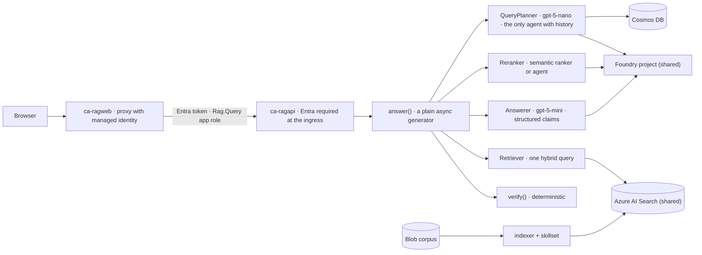

# Regulatory Intelligence Platform

Grounded document intelligence over a controlled corpus with article-level provenance, built on
Microsoft Agent Framework. The system answers questions about the EU AI Act, the Medical Device
Regulation and MDCG guidance **only when the corpus supports it**, cites the article every claim
rests on, verifies every citation before showing it, and proves all three with measured numbers.

[](https://codespaces.new/Rodrigo-GomezdelMoral/azure-rag-platform)
**Live demo:** <https://rodrigo-gomezdelmoral.github.io/azure-rag-platform/> — recorded runs replayed
with their real phase timings, no backend.

[](https://github.com/Rodrigo-GomezdelMoral/azure-rag-platform/actions/workflows/ci.yml)
[](https://github.com/Rodrigo-GomezdelMoral/azure-rag-platform/actions/workflows/eval.yml)

## The problem

A regulatory affairs specialist at a medical-device manufacturer answers *which risk-management
obligations apply to a high-risk AI system embedded in a class IIb device* by reading hundreds of
pages by hand, and the answer is not traceable to the articles it came from. That specialist costs
60–90 € an hour, and a technical file whose evidence a notified body cannot follow delays a CE mark
by months. A chatbot that answers fluently without a citation is worse than the status quo, because
an invented obligation becomes an audit finding. The buyer is the head of regulatory affairs; what
they buy is time, and the proof that every statement points at a real article.

## Architecture



The pipeline is five steps in a fixed order, written as a function rather than a workflow; progress
is streamed as phase events, never as tokens; a claim is shown once, after verification. There is no
virtual network: the boundary is the token, and the browser never holds one. `docs/architecture.md`
has the container table and the request sequence.

## What this demonstrates

| Capability | Where |
|---|---|
| Three agents on Microsoft Agent Framework with structured outputs, instructions as versioned files, no tools | `app/agents.py`, `prompts/` |
| Retrieval as one hybrid query with OData filters and the native semantic ranker, plus an agent reranker for comparison | `app/retrieval.py` |
| Deterministic verification of every citation, typed refusals, cost from token usage | `app/answer.py` |
| Entra authentication at the ingress and the `Rag.Query` app role in the code; the session authorised before it exists | `app/main.py`, `infra/modules/apps.bicep` |
| The index built as configuration by the search service's own identity, with safe re-ingestion and quantised vectors | `ops/index.py`, `docs/adr/001-*.md`, `docs/adr/002-*.md` |
| Local and Foundry evaluators, six datasets with a canary in every adversarial row, a judge to be calibrated against human labels | `eval/`, `docs/evaluation.md` |
| Phase timeline, verified-answer panel, citation panel and a retrieval debug panel with scores and rank deltas | `web/src/main.tsx` |
| Quality gate, evaluation gate with a pull-request comment, canary deployment with rollback, static demo | `.github/workflows/` |
| Eleven architecture decisions, three of them rejections | `docs/adr/` |

## Quick start

With Python 3.12, Node 22 and [Ollama](https://ollama.com) serving `llama3.2:3b` (the Codespace does
all three for you):

```bash
make install
cp .env.example .env
make run
```

The API is at `http://localhost:8000` with authentication off, the planner, reranker and answerer run
on Ollama, and retrieval uses the committed sample of chunks. In a second terminal `make web` builds
the frontend and serves it at `http://localhost:8080` through the same proxy the container uses.
`make check` runs ruff, mypy and the tests, including the budget test.

Against Azure, copy the values of `azd env get-values` into `.env` (the `Makefile` target `lz-env`
imports the landing zone outputs) and set `MODEL_PROVIDER=foundry`; your own login then plays the
API's role through `DefaultAzureCredential`.

## Deploy

```bash
azd up
```

One command provisions `rg-ragplatform-prod-swc` from `infra/` and deploys both containers. The
resource group must exist, the landing zone must be deployed and its outputs imported with
`make lz-env`, and the bootstrap below must have been run once. `make preview` runs
`azd provision --preview`; `make destroy` removes everything the repository created.

### Bootstrap, once per tenant

1. **The API's app registration and app role.** Create an app registration named
   `api-ragplatform-prod`, expose it as `api://<client id>`, set `requestedAccessTokenVersion` to
   `2`, and define an app role `Rag.Query` for applications. Store the client id as
   `API_APP_CLIENT_ID` in the azd environment and as a repository variable.
2. **Grant the role to the frontend.** After `azd up` has created `id-ragweb`, assign `Rag.Query`
   to its service principal through Microsoft Graph (`servicePrincipals/{api}/appRoleAssignedTo`).
   Only identities holding the role can call the API; that is the whole authorisation model
   (ADR-009).
3. **The deployment principal.** `gh-azure-rag-platform` holds Contributor on this resource group,
   Role Based Access Control Administrator on this and the shared group (to assign roles to the
   identities it creates), AcrPush on the shared registry, and — so that pull requests can run
   the evaluation suite — Foundry User on the shared project, Search Index Data Reader on the
   search service and the Cosmos SQL data contributor role on the account.
4. **Repository configuration.** Secrets `AZURE_CLIENT_ID`, `AZURE_TENANT_ID`,
   `AZURE_SUBSCRIPTION_ID`; variables `FOUNDRY_PROJECT_ENDPOINT`, `SEARCH_ENDPOINT`,
   `COSMOS_ENDPOINT`, `CORPUS_CONTAINER_URL`, `API_AUDIENCE`, `API_APP_CLIENT_ID`; an environment
   named `production`; GitHub Pages set to deploy from Actions.

### Federated credentials

The deployment principal has **three** federated credentials, and each workflow must present a
subject that matches one of them exactly:

| Subject | Used by |
|---|---|
| `repo:<owner>/<repo>:pull_request` | `eval.yml` on pull requests |
| `repo:<owner>/<repo>:ref:refs/heads/main` | `eval.yml` on its weekly schedule and manual runs from `main` |
| `repo:<owner>/<repo>:environment:production` | `deploy.yml`, which declares `environment: production` |

`AADSTS700213` (*no matching federated identity record found for presented assertion subject*)
means the subject GitHub sent is not in that table. The usual cause is a job that declares an
`environment`: its token carries the environment subject instead of the branch one, so a workflow
with `environment: production` fails until the third credential exists. Read the subject in the
error message and add it, do not widen an existing one.

## Evaluation

The evaluation of 2026-10-15 — the twelve-item smoke suite, planner `gpt-5-nano`, answerer
`gpt-5-mini`, semantic reranker, report `docs/reports/2026-10-15-smoke-gpt-5-mini-semantic.json`:

| Metric | Mean | Threshold |
|---|---|---|
| Groundedness (Foundry judge, scaled 0–1) | 0.91 | ≥ 0.90 |
| Relevance (Foundry judge, scaled 0–1) | 0.86 | reported |
| Citation precision | 0.82 | ≥ 0.95 |
| Recall at 10 | 0.61 | ≥ 0.85 |
| Correct refusal | 1.00 | ≥ 0.90 |
| False refusal | 0.11 | ≤ 0.05 |
| Canary appearances | 0 | = 0 |

**The merge gate is red** and the repository says so: definition questions do not retrieve the
definitions article, and the planner's rewrite varies between runs. `docs/evaluation.md` explains
each failure; `experiments/` measures the two obvious levers and finds that neither moves recall:
the same twenty-three golden items are missed whichever Answerer or reranker runs, because their
passages are not among the retrieved candidates at all. The eighty-item golden set is
generated and **awaits human verification** (`eval/datasets/REVIEW.md`); no metric computed on it
is published, and the judge's agreement with human labels (κ) is pending the labels in
`eval/datasets/calibration.jsonl`.

## Cost

Measured by the `repo` tag on 2026-10-15: this resource group has cost €0.0008 month to date,
because nothing in it runs between questions; the shared platform it uses has cost €10.36, mostly
the search service. A question costs €0.0025 to €0.005 in tokens with the semantic reranker,
depending on the length of the answer, and about four times that with the agent reranker
(`experiments/002-reranking.md`); a thousand queries cost €2.6 to €5.1. The production projection — 50,000
questions a month, two search replicas, a second region — is about €590 a month, measured unit
prices and stated assumptions in `docs/cost.md`.

## Identities and roles

| Identity | Roles |
|---|---|
| `id-ragapi` | Foundry User on the shared project · Search Index Data Reader · Cosmos SQL data contributor on database `rag` · Monitoring Metrics Publisher · AcrPull |
| `id-ragweb` | app role `Rag.Query` on the API · Monitoring Metrics Publisher · AcrPull |
| `id-ragjobs` | Foundry User · Search Service Contributor and Search Index Data Contributor · Storage Blob Data Contributor on `corpus` · Monitoring Metrics Publisher · AcrPull |
| shared search service | Storage Blob Data Reader on `corpus` |
| `gh-azure-rag-platform` | Contributor on this group · RBAC Administrator on both groups · AcrPush · Foundry User · Search Index Data Reader · Cosmos SQL data contributor |

**There is no secret anywhere in this system: no key, no connection string, no vault to keep them
in.** Every call is made with a managed identity or the developer's own login, storage and Cosmos
have key access disabled, and the CI gate scans the full history for emails and identifiers.
`docs/security.md` maps every threat to the file that mitigates it.

## Decisions

| ADR | Decision |
|---|---|
| [001](docs/adr/001-integrated-vectorisation-and-safe-reingestion.md) | Integrated vectorisation, and what makes re-ingestion safe |
| [002](docs/adr/002-quantisation-and-stored-false.md) | Scalar quantisation and `stored: false`, with measured sizes |
| [003](docs/adr/003-agents-orchestrated-by-a-function.md) | Agents orchestrated by a function, not a workflow |
| [004](docs/adr/004-one-abstraction-seam.md) | One abstraction seam |
| [005](docs/adr/005-streaming-progress-not-tokens.md) | Streaming progress, not tokens |
| [006](docs/adr/006-structured-output-with-programmatic-verification.md) | Structured output with programmatic verification |
| [007](docs/adr/007-judge-calibrated-against-human-labels-and-canaries.md) | A judge calibrated against human labels, and canaries for injection |
| [008](docs/adr/008-prompts-as-files-agents-in-code.md) | Prompts as versioned files, agents in code rather than in Foundry Agent Service |
| [009](docs/adr/009-app-role-authorisation-instead-of-a-network-boundary.md) | App-role authorisation instead of a network boundary |
| [010](docs/adr/010-rejection-of-the-search-context-provider.md) | Rejection: `AzureAISearchContextProvider` hides candidate scores and chunk identity |
| [011](docs/adr/011-rejection-of-key-vault-api-management-front-door-and-aks.md) | Rejection: no Key Vault, no API Management, no Front Door, no AKS |

## Scope and simplifications

- **English only**, four documents, one tenant, one region. The second-language corpus and the
  second region are costed, not built.
- **Budgets, measured.** 59 tracked files against a ceiling of 60, where the specification's figure
  of 42 predates its own mandated layout; 1,397 lines of Python against 1,400, where the
  specification's 1,000 covered application and operations code and this count includes the tests
  and the evaluation harness (application 572, operations 283, evaluation 206, tests 336); 399
  lines of Bicep against 400; 456 of TypeScript against 700. `tests/test_budget.py` enforces each.
- **Citation labels are the heading path Document Intelligence detected.** Where it missed a
  heading, a passage carries the previous section's label — Article 26 of the AI Act is indexed
  under Article 25 — and the citation inherits it. Page numbers are not available in the mode
  that preserves headings (ADR-001).
- **The search service lives in North Europe** while everything else is in Sweden Central,
  because the landing zone could not obtain Basic-tier capacity there on the day it was built.
- **Re-ingestion is a job, not a trigger.** The indexer runs daily and on demand; a changed PDF is
  re-chunked under new keys, which is why evaluation datasets cite labels rather than chunk ids.
- **The deployment workflow updates images with `az containerapp`** rather than `azd deploy`, so
  that the canary revision and its traffic split are explicit; `azd up` remains the way to
  provision and deploy from a workstation.
- **Reasoning effort is set to low** on every model call after measuring that the planner took
  28 seconds at the default; answers take about twenty seconds end to end and the interface shows
  the pipeline rather than hiding it.
