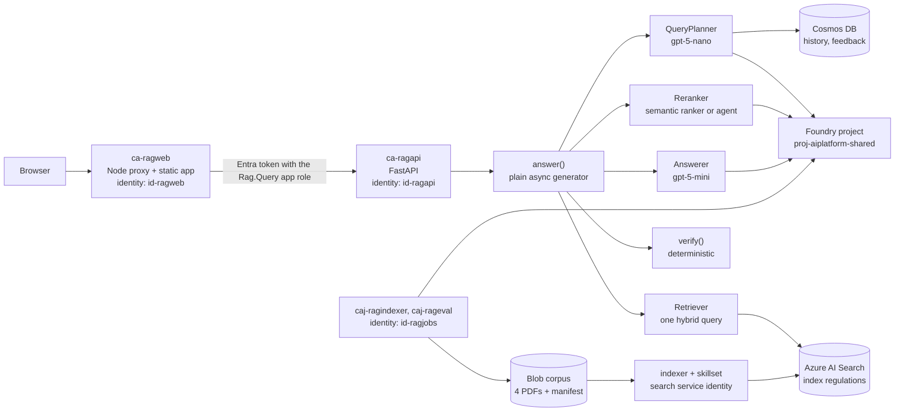
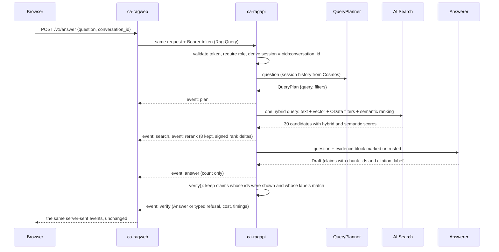

# Architecture

The platform answers questions about EU medical-device and AI regulation with claims that cite the
article they rest on, and refuses when the corpus does not support an answer. The architecture is
domain-agnostic: grounded document intelligence over a controlled corpus with provenance.

## Containers

| Component | Runs | Identity | What it may touch |
|---|---|---|---|
| `ca-ragweb` | `web/server.ts` serving `web/dist` and proxying `/v1/*` | `id-ragweb` | the API, through a token it requests for `api://<client id>` |
| `ca-ragapi` | `app/main.py` on uvicorn, external ingress with Entra authentication required | `id-ragapi` | the Foundry project (Foundry User), the search index (Search Index Data Reader), the `rag` database (Cosmos SQL Data Contributor), Application Insights (Monitoring Metrics Publisher) |
| `caj-ragindexer` | `python -m ops.index`, manual trigger | `id-ragjobs` | the search service (Search Service Contributor, Search Index Data Contributor), the corpus container (Storage Blob Data Contributor), the project |
| `caj-rageval` | `python -m eval.run --suite full`, Mondays 06:00 UTC | `id-ragjobs` | the same, plus Cosmos through the pipeline it runs |
| shared search service | indexer, skillset, index projection | its own system identity | the corpus container (Storage Blob Data Reader), the embedding deployment (through the shared Foundry account) |

Everything shared — Foundry account and project, model deployments, search service, container
registry, Log Analytics, action group — is created by `azure-ai-landing-zone` and referenced here
as `existing` through parameters. This repository creates its resource group's own resources only:
identities, storage, Cosmos, Application Insights, the Container Apps environment, the apps and
jobs, alerts, a budget, and every role assignment, including the ones on shared resources that
the landing zone exports principal ids for.

## One request

The pipeline is a function (ADR-003). Progress is streamed as phase events, never as tokens
(ADR-005): the text of a claim appears once, after verification (ADR-006). Only the planner has
conversation history, and it sees questions and rewritten queries; the answerer sees regulatory
text and has no history. Every model call is made with `store: false`.

## The authorisation boundary

There is no virtual network. The boundary is the token: the API's ingress requires an Entra
token for its audience, the code requires the `Rag.Query` app role in it, and the only identity
holding that role is the frontend container's. The browser never holds a token; the frontend
proxies server-side. ADR-009 records the decision and its trade-offs; `docs/security.md` lists
every identity and role.

## Indexing

`ops/corpus.py` downloads the four official PDFs, hashes them, uploads them with metadata and
writes `data/manifest.json`. `ops/index.py` declares the index, data source, skillset and indexer
as configuration; the search service's own identity reads the corpus, runs Document Intelligence
layout extraction, a Shaper that computes the citation label from the heading path, a Split skill
per section and the embedding skill, and projects one search document per chunk. Re-ingestion is
safe by construction (ADR-001); vectors are stored once, quantised, with originals kept for
rescoring (ADR-002).

## Environments

| Environment | Model | Retrieval | Authentication |
|---|---|---|---|
| Azure (`rg-ragplatform-prod-swc`) | Foundry deployments `gpt-5-mini`, `gpt-5-nano` | Azure AI Search | Entra, app role |
| Local or Codespaces with `MODEL_PROVIDER=ollama` | `llama3.2:3b` through `OllamaChatClient` | `LocalRetriever` over `data/sample-chunks.jsonl` | `REQUIRE_AUTH=false` |
| GitHub Pages demo (`VITE_DEMO_MODE=true`) | none | none — recorded runs in `web/fixtures/` replayed with their real timings | none |

Swapping the model provider is a setting; nothing in `app/agents.py` or `app/answer.py` knows
which client it holds (ADR-004).
